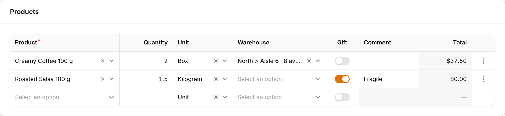

# Filament Data Grid

<picture class="filament-hidden">
  <source media="(prefers-color-scheme: dark)" srcset="art/screenshot-dark.png">
  
</picture>

[](https://github.com/Waguilar33/filament-data-grid/actions/workflows/tests.yml)
[](https://github.com/Waguilar33/filament-data-grid/actions/workflows/phpstan.yml)
[](LICENSE.md)

An editable, spreadsheet-style data grid for Filament forms. Rows are typed in place, with the keyboard, the way people fill in order lines, invoices or stock counts.

`DataGrid` is a form field that extends Filament's `Repeater`, and you build it the same way as `Repeater::make()->table()`. Its cells are your own Filament form components. Read-only cells are infolist entries. Their closures run on the server for each row, so `Get`, `Set`, `live()`, `afterStateUpdated()`, `disabled()`, `required()` and validation rules all work. Validation errors use `Repeater`'s keys, and row actions are Filament Actions.

> [!WARNING]
> This plugin is in beta. You can install and use it, but its API may change before `v1.0.0`.

## Requirements

- PHP 8.2+
- Laravel 11.47+, 12 or 13.32+
- Filament 4.15.2+ or 5.10.2+

## Installation

```bash
composer require waguilar33/filament-data-grid:"^1.0@beta"
```

Until the package is on Packagist, add the GitHub repository to your app's `composer.json` first:

```json
"repositories": [
    { "type": "vcs", "url": "https://github.com/Waguilar33/filament-data-grid" }
]
```

Publish the plugin's assets:

```bash
php artisan filament:assets
```

If your app's `post-autoload-dump` scripts include `@php artisan filament:upgrade`, Filament runs this after every `composer update`. `filament:install` adds that script for you.

You don't need to change your theme or your Vite config. The grid ships its own compiled JavaScript and CSS. The JavaScript loads only on pages that render a grid. The stylesheet (about 3 KB gzipped) loads with every Filament page, so the grid never shifts the page when it appears.

## Basic usage

```php
use Filament\Forms\Components\Hidden;
use Filament\Forms\Components\Repeater\TableColumn;
use Filament\Forms\Components\Select;
use Filament\Forms\Components\TextInput;
use Filament\Infolists\Components\TextEntry;
use Filament\Schemas\Components\Utilities\Get;
use Waguilar\FilamentDataGrid\DataGrid;

DataGrid::make('lines')
    ->table([
        TableColumn::make('Product')->markAsRequired(),
        TableColumn::make('Quantity')->width('8rem')->alignEnd(),
        TableColumn::make('Total')->width('8rem')->alignEnd(),
    ])
    ->schema([
        Select::make('product_id')
            ->options(Product::pluck('name', 'id'))
            ->searchable()
            ->required()
            ->live(),
        TextInput::make('quantity')
            ->numeric()
            ->minValue(1)
            ->required()
            ->live(),
        TextEntry::make('total')
            ->state(fn (Get $get): float => (Product::find($get('product_id'))?->price ?? 0) * (float) $get('quantity'))
            ->money('USD'),
        Hidden::make('id'),
    ])
```

Each `TableColumn` describes one visible component of the schema, in order. `Hidden` fields carry state without taking a column.

Like `Repeater`, the state is an array of rows, and `relationship()` saves them to a `HasMany` relationship:

```php
DataGrid::make('lines')
    ->relationship()
    ->table([...])
    ->schema([...])
```

`Repeater`'s other options still apply. Among them:

- `addable()`
- `deletable()`
- `reorderable()`
- `defaultItems()`
- `minItems()`
- `maxItems()`
- `addActionLabel()`
- `extraItemActions()`
- `disabled()`
- `hiddenLabel()`

## Cells

The grid chooses how to edit each cell from the component you put in the schema:

| Component | In the grid |
| --- | --- |
| `TextInput` | Edited in place. With `numeric()` it aligns right and checks `minValue()`, `maxValue()`, `integer()` and `step()` as you type. |
| `Select` | Filament's own select dropdown. It supports search, the clear button, `allowHtml()`, `multiple()`, `getSearchResultsUsing()`, `getOptionLabelUsing()` and `disableOptionWhen()`. |
| `Radio`, `ToggleButtons` | The same dropdown, listing their options. |
| `Toggle`, `Checkbox` | A switch you click, or flip with Space. |
| `DatePicker`, `DateTimePicker`, `TimePicker` | The browser's date or time input. It respects `minDate()`, `maxDate()` and `displayFormat()`. |
| Any other field | Opens in a modal for that row. For example `ColorPicker`, `Textarea` or your own custom field. |
| An infolist entry, such as `TextEntry` | Read-only. Rendered with Filament's own entry view, so formatting such as `money()` works. |

Editable cells have the background of a Filament input, while read-only and disabled cells are one shade darker. That way users can see what they can change without guessing.

A component that is neither a form field nor an infolist entry throws `Waguilar\FilamentDataGrid\Exceptions\UnsupportedCellComponent`.

### Per-row logic

Closures run once per row, with that row's state:

```php
TextInput::make('comment')
    ->disabled(fn (Get $get): bool => blank($get('product_id'))),

TextInput::make('quantity')
    ->numeric()
    ->minValue(fn (Get $get): float => $get('unit') === 'box' ? 1 : 0.001)
    ->required(fn (Get $get): bool => filled($get('product_id'))),

Select::make('product_id')
    ->live()
    ->afterStateUpdated(fn (Set $set) => $set('quantity', 1)),
```

### Hiding a column header

Use `hiddenHeaderLabel()` on the `TableColumn`, as with `Repeater`. Screen readers still read the header.

## Keyboard

| Key | Action |
| --- | --- |
| Arrow keys | Move between cells. |
| Typing | Start editing a text or number cell, or search a dropdown. |
| F2 | Edit the active cell. |
| Enter on a dropdown or modal cell | Open it. |
| Enter | Save and move down a row. |
| Shift + Enter | Save and move up a row. |
| Tab / Shift + Tab | Save and move right or left. |
| Escape | Cancel the edit. It does not close a surrounding modal. |
| Space | Flip a toggle. |

## Trailing empty row

For fast data entry, keep an empty row at the bottom of the grid. Typing in it turns it into a real row, and a new empty row appears below:

```php
DataGrid::make('lines')
    ->trailingEmptyRow()
```

The empty row is never validated or saved, and it doesn't count toward `minItems()` or `maxItems()`. Once the grid reaches `maxItems()`, no new empty row is added. By default, it becomes a real row when any editable field without a `default()` gets a value. You can choose which fields count by passing `filledBy`:

```php
DataGrid::make('lines')
    ->trailingEmptyRow(filledBy: 'product_id')

DataGrid::make('lines')
    ->trailingEmptyRow(filledBy: ['product_id', 'description'])
```

When the grid has a trailing empty row, the add button is hidden.

## Frozen columns

Keep the first columns in place while the rest scroll sideways:

```php
DataGrid::make('lines')
    ->frozenColumns(1)
```

When the grid is reorderable, the count includes the drag handle column.

## Row actions

Each row has a menu with the delete action and any `extraItemActions()`. These are normal Filament Actions, so they can open modals and slide-overs. The row's key is in `$arguments['item']`:

```php
use Filament\Actions\Action;

DataGrid::make('lines')
    ->extraItemActions([
        Action::make('stock')
            ->icon(Heroicon::OutlinedCube)
            ->slideOver()
            ->schema(fn (array $arguments, DataGrid $component): array => [
                TextEntry::make('available')
                    ->state(fn () => Stock::for($component->getRawItemState($arguments['item'])['product_id'])),
            ]),
    ])
```

If delete is the only action, it appears as a button instead of a menu.

## Reordering

As with `Repeater`, the grid is reorderable by default. Rows are dragged by their handle, and `orderColumn()` works with relationships. To turn reordering off:

```php
DataGrid::make('lines')
    ->reorderable(false)
```

## Editable child rows

A `DataGrid` row can open to show an editable table of its own child rows. Put a nested `DataGrid` in the parent's schema. It doesn't take a column, and it is built like any other `DataGrid`:

```php
use Filament\Forms\Components\Hidden;
use Filament\Forms\Components\Repeater\TableColumn;
use Filament\Forms\Components\TextInput;
use Filament\Infolists\Components\TextEntry;
use Filament\Schemas\Components\Utilities\Get;
use Waguilar\FilamentDataGrid\DataGrid;

DataGrid::make('products')
    ->addable(false)
    ->deletable(false)
    ->reorderable(false)
    ->expandRowsWhen(fn (Get $get): bool => collect($get('places'))->sum('quantity') < $get('requested'))
    ->table([
        TableColumn::make('Product'),
        TableColumn::make('Requested')->alignEnd(),
        TableColumn::make('Assigned')->alignEnd(),
    ])
    ->schema([
        Hidden::make('id'),
        TextEntry::make('name'),
        TextEntry::make('requested')->numeric(),
        TextEntry::make('assigned')->state(fn (Get $get): float => collect($get('places'))->sum('quantity')),
        DataGrid::make('places')
            ->addable(false)
            ->deletable(false)
            ->reorderable(false)
            ->table([
                TableColumn::make('Place'),
                TableColumn::make('Available')->alignEnd(),
                TableColumn::make('Quantity')->alignEnd(),
            ])
            ->schema([
                TextEntry::make('place'),
                TextEntry::make('available')->numeric(),
                TextInput::make('quantity')
                    ->numeric()
                    ->minValue(0)
                    ->maxValue(fn (Get $get): mixed => $get('available'))
                    ->live(),
            ]),
    ])
```

- **Which child grid:** a row shows the first nested `DataGrid` in its schema that is visible for that row. Use `visible()` to give different rows different child tables, such as quantities per place for some products and a code per unit for others. A row whose nested grids are all hidden has no child rows.
- **State:** the nested grid's state lives inside its parent row, with `Repeater`'s nested keys: `data.products.{uuid}.places.{uuid}.quantity`. The parent row's closures see it through `Get`, so a parent cell such as `assigned` updates when a child cell changes.
- **Validation:** errors use those nested keys. The invalid child cell shows its message, and its parent row is marked as having errors in its child rows.
- **Opening rows:** `expandRowsWhen()` takes a boolean or a closure that runs for each row. The closure receives the row's raw state as `array $state`, and `Get $get` reads that row's fields. Rows are closed by default.
- **Spacing:** the child table sits 15 pixels in from every side of the open row; change that with `childTablePadding(8)`.

## Read-only grid with child rows

`DataGridEntry` is an infolist entry that shows rows in the same grid, read-only. Each row can open to show its own child rows, with their own columns. It extends Filament's `RepeatableEntry`, so you build it the same way as `RepeatableEntry::make()->table()`:

```php
use Filament\Infolists\Components\RepeatableEntry;
use Filament\Infolists\Components\RepeatableEntry\TableColumn;
use Filament\Infolists\Components\TextEntry;
use Waguilar\FilamentDataGrid\DataGridEntry;

DataGridEntry::make('deliveries')
    ->state(fn (): array => $deliveries)
    ->searchable(['delivery_number', 'customer'])
    ->paginated([10, 25, 50])
    ->table([
        TableColumn::make('Delivery'),
        TableColumn::make('Customer'),
        TableColumn::make('Warehouse')->width('12rem'),
    ])
    ->schema([
        TextEntry::make('delivery_number'),
        TextEntry::make('customer'),
        TextEntry::make('fill_status')->badge(),
        RepeatableEntry::make('lines')
            ->table([
                TableColumn::make('Product'),
                TableColumn::make('Requested')->alignEnd(),
                TableColumn::make('Handed over')->alignEnd(),
            ])
            ->schema([
                TextEntry::make('product'),
                TextEntry::make('requested')->numeric(),
                TextEntry::make('handed_over')->numeric(),
            ]),
    ])
```

The state can be an array, a collection or a relationship, as with `RepeatableEntry`.

- **Child rows** come from the first `RepeatableEntry` in the schema that has a `table()`. It doesn't take a column. Its rows open under their parent row as a small table of their own, with its own column headers. Without one, the grid has no child rows. The child table sits 15 pixels in from every side of the open row; change that with `childTablePadding(8)`.
- **Opening rows:** rows start closed. Click a row, or its arrow button, to open or close it. Several rows can be open at once.
- **Search:** `searchable()` adds a search field that filters parent rows. A row's child rows stay with it. Pass a list of fields to search only those columns. The search matches the text the entries show, such as a badge's formatted label.
- **Pagination:** `paginated([10, 25, 50])` pages parent rows and lets users pick the page size, with Filament's own pagination controls. Add `DataGridEntry::ALL_RECORDS` to offer "All", and use `defaultPaginationPageOption(25)` to start on another size. `paginated(10)` gives a fixed size, and `paginated()` uses 10, 25 and 50. Open child rows don't count toward the page size, so a parent row and its children are never split across pages.

### Content above and below the child rows

An open row can show your own content above and below its child table, such as the delivery's address and phone above its products. Pass any Filament schema components; they use the row's data, like entries in an infolist:

```php
DataGridEntry::make('deliveries')
    ->expandedAbove([
        Grid::make(3)->schema([
            TextEntry::make('address'),
            TextEntry::make('phone'),
            TextEntry::make('route')->badge(),
        ]),
    ])
    ->expandedBelow(fn (array $state): array => filled($state['notes'] ?? null)
        ? [TextEntry::make('notes')]
        : [])
```

A closure receives the row's `$state` (and `$record` for Eloquent rows) and returns the components for that row, or an empty array for none. A row with content above or below, but no child table, still opens. The content sits inside the same inset panel as the child table, and the row grows to fit it.

### Row height

Each parent and child row grows to fit its tallest cell, so text can wrap and an entry's `belowContent()`, such as a code badge under a product name, shows in full. A row is never shorter than 44 pixels, and the cells stay centred vertically:

```php
use Filament\Schemas\Components\Text;

TextEntry::make('product')
    ->belowContent(fn (?OrderLine $record): ?Text => filled($record?->code)
        ? Text::make($record->code)->badge()->color('gray')
        : null),
```

The browser measures each row once, at the current column widths, and measures again when the rows or the column widths change. To skip measuring, give every parent row the same height with `rowHeight(56)`, or pick it per row from the row's state, returning `null` to measure that row:

```php
DataGridEntry::make('deliveries')
    ->rowHeight(fn (array $state): ?int => count($state['holds']) > 2 ? 72 : null)
```

Child rows are always measured. A fixed height doesn't make the content fit, so content taller than the row is cut off.

### Heading, description and icon

Like a section, the grid can have a heading, a description and an icon above it:

```php
DataGridEntry::make('deliveries')
    ->heading('Deliveries')
    ->description('Where each order on the route stands.')
    ->icon(Heroicon::OutlinedTruck)
```

### Filters

`filters()` takes Filament's own table filters. They appear behind the filter button next to the search field, with the same form, "Apply filters" and "Reset" as a Filament table:

```php
use Filament\Tables\Filters\SelectFilter;
use Filament\Tables\Filters\TernaryFilter;

DataGridEntry::make('deliveries')
    ->filters([
        SelectFilter::make('fill_status')->options(['complete' => 'Complete', 'partial' => 'Partial']),
        SelectFilter::make('customer')->multiple()->options($customers),
        TernaryFilter::make('is_late'),
    ])
```

The grid applies `SelectFilter` and `TernaryFilter` itself, by comparing each row's `attribute()` (the filter's name by default) with the chosen value. Any other filter, such as a plain `Filter` with a custom query, needs `records()`. As with Filament's custom data tables, `records()` receives the filter state as `$filters`, for example `['fill_status' => ['value' => 'partial'], 'customer' => ['values' => ['Ana']]]`, and applies it itself.

### Inside a Filament table

To let Filament handle searching, filtering and paging, build a normal Filament table and use the grid as its content. Filament keeps everything around the rows: the heading, search field, filters (in a dropdown, modal or slide-over), active filter chips, pagination, empty state and header actions. The grid draws only the current page of records, with child rows that open:

```php
use Filament\Tables\Table;
use Waguilar\FilamentDataGrid\DataGridEntry;

public function table(Table $table): Table
{
    return $table
        ->query(Delivery::query())
        ->columns([TextColumn::make('number')->searchable()])
        ->filters([SelectFilter::make('fill_status')->options([...])])
        ->filtersTriggerAction(fn (Action $action) => $action->slideOver())
        ->content(
            DataGridEntry::make('deliveries')
                ->table([...])
                ->schema([...])
                ->toTableContent(),
        );
}
```

`toTableContent()` uses Filament's `content()` hook, so the table works the same as any other Filament table, with `query()` or `records()`. Each parent row also shows the table's `recordActions()` (Filament Actions, so their modals and slide-overs work as usual) and, when the table has a `recordUrl()`, a chevron that opens the record. Clicking the row opens the record too; the arrow at the start of the row opens its child rows. It works in a relation manager, whose table already has the relationship query. Define the grid's columns with `table()` and `schema()` as above. The table's `columns()` still decide what can be searched and sorted, but aren't shown. Leave `searchable()`, `filters()` and `paginated()` off the grid itself here, because the table does that work.

To give the table's heading an icon, like a section's, pass the heading through `IconHeading`. It works on any Filament table, with or without the grid:

```php
use Waguilar\FilamentDataGrid\Support\IconHeading;

$table
    ->heading(IconHeading::make('Deliveries', Heroicon::OutlinedTruck))
    ->description('Where each order on the route stands.')
```

Cells are Filament infolist entries, so their own options work in the grid. For example, a `TextEntry` with `badge()` and an array state shows one badge per item, and an `IconEntry` with `tooltip()` makes an icon-only column:

```php
IconEntry::make('kind')
    ->icon(fn (string $state) => $state === 'pickup' ? Heroicon::OutlinedHandRaised : Heroicon::OutlinedTruck)
    ->tooltip(fn (string $state) => ucfirst($state)),
TextEntry::make('holds')->badge(),
```

To use the same child table on its own elsewhere, build its `table()` columns and `schema()` entries in a method of your own that returns new instances on every call, and pass them both to a nested `RepeatableEntry` and to a standalone `DataGridEntry`.

### Searching, filtering and paging it yourself

By default, the server sends every row with the page, and search and pagination run in the browser. Results are instant and nothing goes back to the server, which suits grids of up to a few hundred parent rows whose size you know.

For larger or unknown sizes, make the entry server-side. The page then loads only the first page of rows, and each search, page or page size change asks the server for the rows it needs:

```php
DataGridEntry::make('deliveries')
    ->serverSide()
    ->state(fn (): array => $deliveries)
```

With only `state()`, the server still reads every row on each request, but renders and sends only the current page. To let your data source do the work, as with Filament's [custom data tables](https://filamentphp.com/docs/5.x/tables/custom-data), use `records()`. It receives the search, the page and the page size (`null` for "All"), and returns a `LengthAwarePaginator`, or an array or collection that the grid pages for you:

```php
use Illuminate\Pagination\LengthAwarePaginator;

DataGridEntry::make('deliveries')
    ->serverSide()
    ->records(fn (?string $search, int $page, ?int $recordsPerPage): LengthAwarePaginator => Delivery::query()
        ->when($search, fn ($query) => $query->where('number', 'like', "%{$search}%"))
        ->paginate($recordsPerPage ?? PHP_INT_MAX, page: $page))
```

Search terms and page numbers come from the browser. As with Filament's custom data, `records()` must return only data the current user may see.

To make every grid in your app server-side, set it once in a service provider. A grid can still opt out with `serverSide(false)`:

```php
DataGridEntry::configureUsing(fn (DataGridEntry $entry) => $entry->serverSide());
```

## Validation

Validation runs on the server through Filament, using `Repeater`'s keys (`data.lines.{uuid}.quantity`). Invalid cells are outlined in red and show their message on hover. A summary below the grid lists each error by row and column:

```text
Row 2 · Quantity: The quantity field is required.
```

Number and date cells also check their limits in the browser as you type, before any request is sent.

## Translations

The plugin ships English and Spanish translations. To change them, publish the files:

```bash
php artisan vendor:publish --tag=filament-data-grid-translations
```

Server-side validation messages come from Laravel's `lang/{locale}/validation.php`, as with any Filament field.

## Styling

Every element uses `fi-data-grid-*` hook classes and Filament's color variables, so the grid follows your panel's colors and dark mode. The grid's own colors are CSS variables that you can override in your theme:

```css
.fi-data-grid {
    --fi-data-grid-editable-bg: var(--primary-50);
}

.dark .fi-data-grid {
    --fi-data-grid-editable-bg: color-mix(in oklab, var(--primary-400) 10%, transparent);
}
```

## Icons

Every icon the plugin draws goes through Filament's [icon aliases](https://filamentphp.com/docs/5.x/styling/icons#replacing-the-default-icons), so you can replace them in a service provider like any Filament icon:

```php
use Filament\Support\Facades\FilamentIcon;
use Waguilar\FilamentDataGrid\View\DataGridIconAlias;

FilamentIcon::register([
    DataGridIconAlias::ROW_EXPAND => 'fal-sharp-chevron-right',
]);
```

| Alias | Icon |
| --- | --- |
| `DataGridIconAlias::ROW_EXPAND` (`filament-data-grid::row.expand`) | The arrow that opens a row's child rows. |
| `DataGridIconAlias::ROW_OPEN` (`filament-data-grid::row.open`) | The chevron that opens a record, inside a Filament table. |
| `DataGridIconAlias::ROW_ACTIONS` (`filament-data-grid::row.actions`) | The row menu of the editable grid. |
| `DataGridIconAlias::CELL_REORDER` (`filament-data-grid::cell.reorder`) | The drag handle. |
| `DataGridIconAlias::CELL_DATE` (`filament-data-grid::cell.date`) | The calendar in date cells. |
| `DataGridIconAlias::CELL_EDIT` (`filament-data-grid::cell.edit`) | The pencil in cells that open a modal. |

The search, filter and pagination icons are Filament's own, under its table and pagination aliases.

## How it works

The grid is drawn with [SlickGrid-Universal](https://github.com/ghiscoding/slickgrid-universal) inside a `wire:ignore` element. SlickGrid-Universal is bundled with the plugin, so your app doesn't install it.

The server renders the rows, the cell descriptions and the row actions, and sends them to the browser as JSON. Every edit is written back to the field's state through Livewire.

## Limitations

- The whole grid is sent again on every update. 200 rows take about 47 ms on the server and 11 KB gzipped, which is fine for grids the size of an order. Grids with thousands of rows aren't a good fit yet.
- There are no footer totals yet. Show totals with an entry or a field outside the grid.
- The compiled JavaScript is about 88 KB gzipped for `DataGrid` and 57 KB for `DataGridEntry`, most of it SlickGrid-Universal's grid. It loads only on pages with a grid.
- The select dropdown is Filament's own JavaScript, copied into the plugin's build from Filament 5. The same build runs on Filament 4. Check the grid after upgrading Filament.

## Testing

```bash
composer test
```

The browser tests use [Pest's browser plugin](https://pestphp.com/docs/browser-testing). Install Chromium once with `npx playwright install chromium`.

To try the grid in a demo panel:

```bash
composer install
npm install
composer serve
```

Then open http://127.0.0.1:8000/demo/data-grid-demo.

After changing any JavaScript or CSS, run `npm run build` and commit `resources/dist`.

## Changelog

Please see [CHANGELOG](CHANGELOG.md) for what has changed recently.

## Contributing

Please see [CONTRIBUTING](.github/CONTRIBUTING.md) for details.

## Security Vulnerabilities

Please review [our security policy](../../security/policy) on how to report security vulnerabilities.

## Credits

- [William Aguilar](https://github.com/Waguilar33)
- [All Contributors](../../contributors)

The compiled assets include [SlickGrid-Universal](https://github.com/ghiscoding/slickgrid-universal), [Floating UI](https://github.com/floating-ui/floating-ui), [SortableJS](https://github.com/SortableJS/Sortable) and the select component from [Filament](https://github.com/filamentphp/filament), all MIT licensed. Their license notices are in [`resources/dist/THIRD-PARTY-LICENSES.txt`](resources/dist/THIRD-PARTY-LICENSES.txt).

## License

The MIT License (MIT). Please see [License File](LICENSE.md) for more information.
